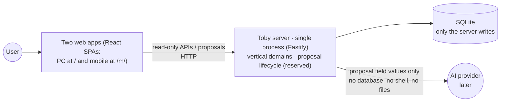
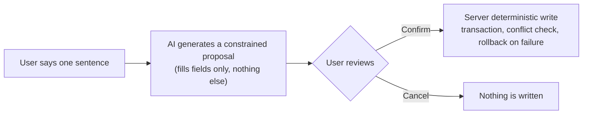

# Toby Agent Guide

English | [简体中文](AGENTS.zh.md)

Rules for AI working in this repository: what this project is, what must never be done, and what to verify after changes.

> **Current status: framework phase.** The command tables and directory layout below describe the target state once the framework lands; until then, `PLAN.md` is authoritative.

## The project in one minute

One sentence: **a self-hosted personal assistant — the user says one sentence in a chat box, the AI generates a constrained proposal, the user confirms, and only then does the server write.** (The proposal pipeline is an architectural reservation; it lands with the chat domain.)

There is exactly one path that writes data:

Dig deeper: `docs/README.md` (documentation index) → `docs/features/` (per-domain contracts) → `docs/system-overview.md` (the full map).

## Communication style

The user has dyslexia and reads Chinese most comfortably. Replies and development docs written for the user follow this style:

- Always prioritize: easy to read, easy to find the point, easy to act on.
- Conclusion first, explanation after. Get to the point; no preamble, no filler.
- Short sentences. One idea per sentence; no complex long sentences.
- Clear structure. Break long content into short paragraphs or lists, but do not over-fragment.
- Reduce reading complexity without dropping technical information. Never omit necessary context for brevity.
- Keep terminology, code, commands, and paths exact.

## Before you start: four things

1. Run `git status --short` — never touch or revert uncommitted changes that are not yours.
2. Find the document that currently counts (feature docs + ADRs) from `docs/README.md`; do not trust memory.
3. Check for an existing implementation first; do not build a parallel one.
4. If code and docs disagree and the conflict involves data / security / public interfaces: stop and ask the user; do not pick a side yourself.

## Iron laws (violating any one counts as an incident)

**Data**

- Everything under `data/` is production data. Nobody touches it by default; only maintenance tasks the user explicitly names may touch it.
- Before and after moving or restoring data, compare **SHA-256** checksums.
- Only the server (`apps/server`) writes to the databases. Web, AI, and scripts never connect to a database directly.

**Write path**

- Every create/update/delete must go through the "AI proposal → user confirmation → server transactional write" pipeline; any write endpoint that bypasses it is a defect.
- No write endpoints exist in the framework phase; later domain write endpoints must use the proposal pipeline and come with an ADR.
- The AI produces field values only: no database, no shell, no file paths, no tool calls.

**Secrecy**

- API keys, tokens, certificate private keys, server credentials, personal sensitive data, full production logs: never enter source code, docs, tests, snapshots, or commits — nowhere.

**Code boundaries**

- The server is sliced into vertical domains: `apps/server/src/domains/<domain>/` self-assembles; **domains never import each other**; cross-domain wiring happens only in the composition root `apps/server/src/main.ts`.
- `infrastructure/` never imports business domains; a domain's `types.ts` stays pure (no fastify / infrastructure / `node:` imports).
- The two web apps (`apps/web` and `apps/web-mobile`) never import each other; cross-app sharing goes only through `@toby/contract` (pure logic) and `@toby/ui` (pure components).
- Dependency direction is always `apps → packages`: packages never import apps; the web apps never import `@toby/server`.
- These boundaries are machine-enforced by ESLint `no-restricted-imports`; a violation fails the build.
- `.ts` sources run directly on Node 22 with no build step. No `enum` / `namespace` / constructor parameter properties; use `import type` (`erasableSyntaxOnly` catches violations automatically).
- No Python; introducing it requires an ADR first.

**Process and commits**

- Commit messages and code comments in **English**; Conventional Commits with English scopes (e.g. `feat(schedule): add month view`).
- Everything merged into `main` goes through a PR: feature branch → all four CI checks (lint / typecheck / test / docker) green → squash merge.
- Update the matching `docs/features/` document only when a contract changes; pure implementation changes do not touch it. Architecture changes come with a new ADR in `docs/decisions/`. Progress is tracked by commit history.

**Tests and verification**

- Tests use temporary data directories and fake AI / logger implementations; production data is never touched, not one byte.
- Automated tests never call real AI, never deploy remotely, never write production data. Running any of those requires explicit authorization in the task, and their results are reported separately from local automation.

## Common commands

All run from the repo root:

| Command | What it does |
| --- | --- |
| `pnpm run dev` | Start dev: server 8629 → web 8630 / web-mobile 8631 |
| `pnpm run start` | Production: build webs, single server process serves pages and API |
| `pnpm run check` | Full check: typecheck / lint / format / test |
| `pnpm run typecheck` | Type checks only |
| `pnpm run lint` | ESLint only (including boundary rules) |
| `pnpm run format` / `format:check` | Prettier format / check |
| `pnpm run test` | All tests (per-package + root HTTP integration tests) |
| `pnpm run build` | Build both web apps |

Ports, processes, and deployment details live in `docs/operations/` — not repeated here.

## What you changed is what you run

| Change | Must run |
| --- | --- |
| `apps/server/` code | `pnpm run test` (domain tests + root integration tests) |
| `apps/web/`, `apps/web-mobile/`, `packages/contract/`, `packages/ui/` | `pnpm run test` + `pnpm run typecheck` |
| TS/JS sources or ESLint/Prettier config | `pnpm run lint`, `pnpm run format:check` |
| `package.json`, lockfile, workspace config | `pnpm install --frozen-lockfile`, `pnpm run check` |
| `Dockerfile` / `compose.yaml` / `.dockerignore` | `docker compose build && docker compose up -d`; healthcheck must report healthy |
| Markdown or document paths | Check links and old path references in affected docs; run `git diff --check` |

If one change touches several rows, run all the checks those rows list.
