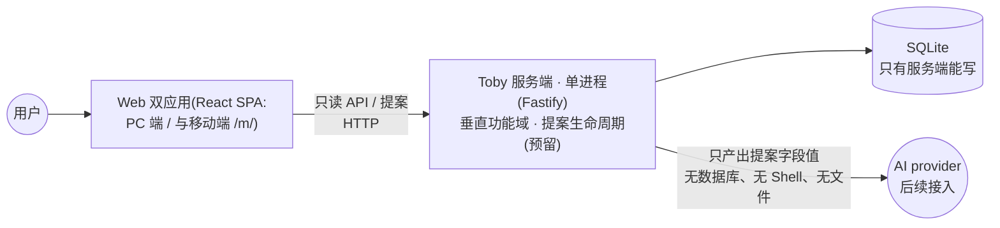
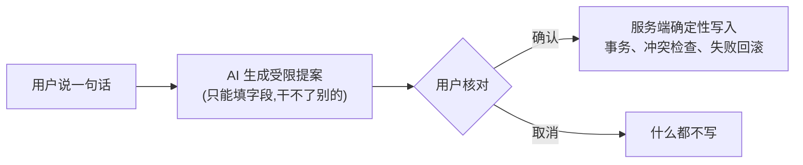

# Toby Agent 工作指南

[English](AGENTS.md) | 简体中文

给 AI 看的仓库规则:这是什么项目、什么绝对不能做、改完要验证什么。

> **当前状态:框架搭建阶段。** 下文的命令表与目录结构是框架合入后的目标形态;在此之前以 `PLAN.md` 为准。

## 一分钟看懂这个项目

一句话:**自托管个人助手——用户跟一个对话框说一句话,AI 生成受限提案,用户确认,服务端才写入。**(提案管线是架构预留,随对话域落地)

写数据的路只有一条:

想深入看:`docs/README.md`(文档总入口)→ `docs/features/`(各域契约)→ `docs/system-overview.md`(完整地图)。

## 表达规范

用户有阅读障碍,中文阅读最省力。写给用户的回复和开发文档,都按下面的方式组织:

- 始终优先:容易读、容易找重点、容易执行。
- 先结论,后解释。直接说重点,不铺垫、不套话。
- 短句为主。一句话只表达一个意思,不写复杂长句。
- 结构清晰。长内容拆成短段或列表,但不过度分段。
- 降低表达复杂度,不减少技术信息。不为简洁省略必要上下文。
- 术语、代码、命令、路径保持准确。

## 动手前,四件事

1. 跑 `git status --short`——工作区里别人的改动,不碰也不回退。
2. 从 `docs/README.md` 找到「当前算数」的那份文档(功能文档 + ADR),别信记忆。
3. 先查有没有现成实现,别造平行方案。
4. 代码和文档打架、又牵扯数据/安全/对外接口?停下来问用户,别自己挑边。

## 铁律(违反任何一条都算事故)

**数据**

- `data/` 下所有库与文件都是正式数据。平时谁也不许改;只有用户明确点名的维护任务才能动。
- 挪动或恢复前后,必须比对 **SHA-256**。
- 数据库只有服务端(`apps/server`)能写。Web、AI、脚本都不许直连数据库。

**写路径**

- 一切新增/修改/删除必须走「AI 提案 → 用户确认 → 服务端事务写入」管线;任何绕过它的写接口都算缺陷。
- 框架期不允许出现任何写接口;后续业务域的写接口必须走提案管线并伴随 ADR。
- AI 只产字段值:无数据库、无 Shell、无文件路径、无工具调用。

**保密**

- API key、Token、证书私钥、服务器凭据、个人敏感数据、完整生产日志:不进源码、文档、测试、快照、提交,哪儿都不进。

**代码边界**

- 服务端是垂直域切片:`apps/server/src/domains/<域>/` 自装配,**域互不导入**;跨域接线只在组合根 `apps/server/src/main.ts`。
- `infrastructure/` 不导入业务域;域内 `types.ts` 保持纯净(禁 fastify / infrastructure / `node:`)。
- 双 web(`apps/web` 与 `apps/web-mobile`)互不导入;跨端共享只经 `@toby/contract`(纯逻辑)与 `@toby/ui`(纯组件)。
- 依赖方向永远 `apps → packages`:packages 不许 import apps;前端不许 import `@toby/server`。
- 以上边界由 ESLint `no-restricted-imports` 机器强制,违规即构建失败。
- `.ts` 源码由 Node 22 直接跑,没有构建步骤。禁 `enum` / `namespace` / 类参数属性;类型导入用 `import type`(`erasableSyntaxOnly` 自动拦违规)。
- 禁 Python;引入前必须先有 ADR。

**流程与提交**

- 提交信息与代码注释用**英文**;Conventional Commits,scope 用英文域名(如 `feat(schedule): add month view`)。
- 一切进 `main` 的改动走 PR:特性分支 → 四项 CI 检查(lint / typecheck / test / docker)全绿 → squash 合并。
- 契约变了才更新 `docs/features/` 对应文档,纯实现细节变化不用碰;架构变化伴随 `docs/decisions/` 新 ADR;进度以提交历史为准。

**测试与验证**

- 测试用临时数据目录与假的 AI / 日志实现,正式数据一个字节不碰。
- 自动化测试不调真实 AI、不远程部署、不写正式数据。真要跑这些,任务必须明确授权,结果与本地自动化分开报告。

## 常用命令

都在仓库根目录跑:

| 命令 | 干什么 |
| --- | --- |
| `pnpm run dev` | 起开发环境:server 8629 → web 8630 / web-mobile 8631 |
| `pnpm run start` | 生产模式:构建前端,单进程服务端提供页面与 API |
| `pnpm run check` | 全量检查:typecheck / lint / format / test |
| `pnpm run typecheck` | 仅类型检查 |
| `pnpm run lint` | 仅 ESLint(含域边界纪律) |
| `pnpm run format` / `format:check` | Prettier 格式化 / 校验 |
| `pnpm run test` | 全部测试(各包 + 根 HTTP 集成测试) |
| `pnpm run build` | 构建两个 web |

端口、进程、部署细节看 `docs/operations/`,这里不重复。

## 改了什么,就跑什么

| 改动 | 必须执行 |
| --- | --- |
| `apps/server/` 代码 | `pnpm run test`(域测试 + 根集成测试) |
| `apps/web/`、`apps/web-mobile/`、`packages/contract/`、`packages/ui/` | `pnpm run test` + `pnpm run typecheck` |
| TS/JS 源码或 ESLint/Prettier 配置 | `pnpm run lint`、`pnpm run format:check` |
| `package.json`、lockfile、workspace 配置 | `pnpm install --frozen-lockfile`、`pnpm run check` |
| `Dockerfile` / `compose.yaml` / `.dockerignore` | `docker compose build && docker compose up -d`,healthcheck 应为 healthy |
| Markdown 或文档路径 | 查受影响文档的链接和旧路径引用,跑 `git diff --check` |

一次改到好几样,就把各行的检查都跑了。
