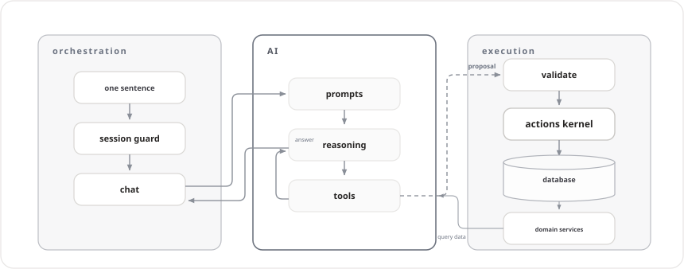

# Toby

**Self-hosted AI assistant: everyday writes land at once (revertible); destructive ones still wait for your confirm.**

English | [简体中文](README.zh.md)

Say one sentence — your money, schedule, and notes fall into place. The AI turns your words into a structured **write card** (what to record, where, and with which values) and the server performs a deterministic, transactional write. Everyday additive writes land immediately — the card is a receipt with a minutes-long revert window; destructive operations (rewriting your notes, redefining trackers) still show a confirm card first. Every write goes through the actions kernel — and the AI has no write access of its own.

```text
      ┌─ You ──────────────────────────────────────────┐
      │ Yesterday's lunch cost 30                      │
      └────────────────────────────────────────────────┘

      ┌─ Toby · written ✓ ─────────────────────────────┐
      │ Expense · Dining · ¥30.00                      │
      │ Date 2026-10-22 · Account not linked           │
      │                                                │
      │ [ Revert (within 10 min) ]                     │
      └────────────────────────────────────────────────┘
```

## 🏗️ Architecture

One process: deterministic orchestration and execution on the sides, a fenced AI loop in the middle — **the AI only drafts; every way in and out is deterministic.** The full picture, including the end-to-end sequence of a single write, is in [docs/system-overview.md](docs/system-overview.md).



## 🤖 Features

**Available today**

- One-sentence bookkeeping: speak (or type) an expense or income; it lands at once as a receipt card with a revert window
- Login protection for deployments, PC (`/`) and mobile (`/m/`) web apps
- Self-hosted and single-user: your data stays in local SQLite files on your machine

**On their way**

- Schedule, notes, todos, and a personal library — each lands as a domain with its own contract (see [docs/features/](docs/features/))

> **Current phase:** live domains are whatever sits in [`apps/server/src/domains/`](apps/server/src/domains/); `docs/features/` holds the target contracts. Details in [AGENTS.md](AGENTS.md).

## 🚀 Quick start

Requirements: Node.js `22.23.2` (pinned exactly — other 22.x versions are rejected by `engine-strict`) and pnpm `11.18.0` (`corepack enable`). All commands run from the repo root.

```bash
pnpm install

pnpm run dev      # dev mode: PC http://127.0.0.1:8630/ , mobile http://127.0.0.1:8631/m/ , API proxied to server
pnpm run start    # production mode: build webs, single server process serves pages and API

docker compose up -d --build    # deploy with Docker — manual: docs/operations/docker.md
```

No `.env` is needed for the default run. AI is optional: the one-sentence ledger path needs `TOBY_AI_MODEL` plus the matching provider key — copy `.env.example` and see [docs/operations/local-dev.md](docs/operations/local-dev.md) for ports, processes, and deployment notes.

The name: **8629** — the server's port — spells TOBY on a T9 keypad.

## 📚 Documentation

- [docs/product-overview.md](docs/product-overview.md) — the product, user-facing
- [docs/system-overview.md](docs/system-overview.md) — architecture
- [docs/features/](docs/features/) — per-domain target contracts
- [docs/design/](docs/design/) — visual design principles
- [docs/decisions/](docs/decisions/) — architecture decision records (ADRs)
- [docs/operations/](docs/operations/) — local dev, ports, deployment notes
- [CONTRIBUTING.md](CONTRIBUTING.md) — how to contribute ([中文](CONTRIBUTING.zh.md))
- [AGENTS.md](AGENTS.md) — rules for AI coding agents ([中文](AGENTS.zh.md)). Using an AI agent to work on this repo? Point it at this file.
- [PLAN.md](PLAN.md) — framework build plan

## 🎓 Learning project

Toby is a personal project built for learning — a hands-on practice in building a self-hosted AI application end to end. Feel free to read the code and docs for reference.

## 📄 License

[MIT](LICENSE)
