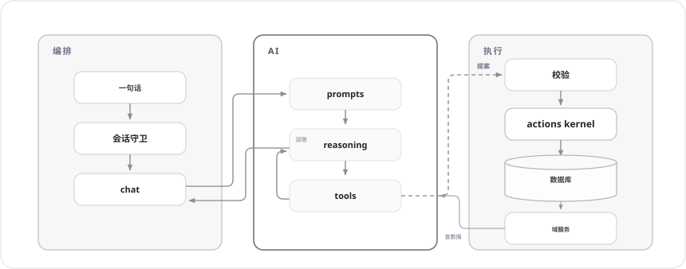

# Toby

**自托管 AI 助手:日常写入即刻落库、可撤回;破坏性改动仍先问过你。**

[English](README.md) | 简体中文

一句话说清——账、日程、笔记各就各位。AI 把你的话变成一张结构化**写入卡**(记什么、记到哪儿、什么值),服务端随即执行确定性事务写入。日常追加类写入即刻落库——卡是凭据,带几分钟的撤回窗口;破坏性操作(改写笔记、调整记录项定义)仍先出确认卡。一切写入都经 actions kernel——AI 自己没有任何写权限。

```text
      ┌─ 你 ───────────────────────────────────────────┐
      │ 昨天午饭花了 30                                │
      └────────────────────────────────────────────────┘

      ┌─ Toby · 已写入 ✓ ──────────────────────────────┐
      │ 支出 · 餐饮 · ¥30.00                           │
      │ 日期 2026-10-22 · 账户 未关联                  │
      │                                                │
      │ [ 撤回(10 分钟内) ]                           │
      └────────────────────────────────────────────────┘
```

## 🏗️ 架构

一个进程:两侧是确定区(编排与执行),中间是围栏里的 AI——**AI 只起草,进出都是确定区。**完整架构与一次写入的端到端时序见 [docs/system-overview.zh.md](docs/system-overview.zh.md)。



## 🤖 功能

**已可用**

- 一句话记账:说出(或输入)一笔收支,即刻落库为凭据卡,带撤回窗口
- 部署可开启登录保护,PC(`/`)与移动端(`/m/`)双 Web 应用
- 自托管、单用户:数据保存在你机器上的本地 SQLite 文件里

**陆续到来**

- 日程、笔记、待办与个人书库——每个功能作为一个业务域落地,各带契约文档(见 [docs/features/](docs/features/))

> **当前阶段:** 已上线域以 [`apps/server/src/domains/`](apps/server/src/domains/) 目录为准;`docs/features/` 存放目标契约。详见 [AGENTS.zh.md](AGENTS.zh.md)。

## 🚀 快速开始

环境要求:Node.js `22.23.2`(精确锁版——其他 22.x 版本会被 `engine-strict` 拒绝)、pnpm `11.18.0`(`corepack enable`),命令均在仓库根目录执行。

```bash
pnpm install

pnpm run dev      # 开发模式:PC http://127.0.0.1:8630/ ,移动端 http://127.0.0.1:8631/m/ ,API 由 Vite 代理到 server
pnpm run start    # 生产模式:构建前端,单进程服务端同时提供页面与 API

docker compose up -d --build    # Docker 部署 —— 手册: docs/operations/docker.zh.md
```

默认运行无需 `.env`。AI 为可选:一句话记账路径需设置 `TOBY_AI_MODEL` 与对应供应商密钥——复制 `.env.example`,端口、进程与部署说明见 [docs/operations/local-dev.zh.md](docs/operations/local-dev.zh.md)。

名字的由来:**8629** —— 服务端端口 —— 在 T9 键盘上正好拼出 TOBY。

## 📚 文档

- [docs/product-overview.md](docs/product-overview.md) —— 产品介绍(面向用户)
- [docs/system-overview.md](docs/system-overview.md) —— 系统架构
- [docs/features/](docs/features/) —— 各域目标契约
- [docs/design/](docs/design/) —— 视觉设计理念
- [docs/decisions/](docs/decisions/) —— 架构决策记录(ADR)
- [docs/operations/](docs/operations/) —— 本地开发、端口与部署说明
- [CONTRIBUTING.zh.md](CONTRIBUTING.zh.md)([英文](CONTRIBUTING.md))—— 贡献指南
- [AGENTS.zh.md](AGENTS.zh.md)([英文](AGENTS.md))—— AI 编码代理工作规则。用 AI 代理开发本仓库?让它读这个文件。
- [PLAN.md](PLAN.md) —— 框架搭建计划

## 🎓 学习项目

Toby 是学习用途的个人项目,用于动手实践自托管 AI 应用的完整构建;欢迎参考代码与文档。

## 📄 许可证

[MIT](LICENSE)
