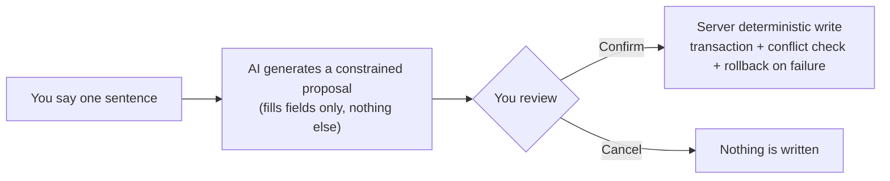

# Product Overview

English | [简体中文](product-overview.zh.md)

> Status: Active (product target)
>
> Created: 2026-10-10
>
> Current phase: framework. This document describes the target shape; engineering status lives in [README.md](README.md).

## Positioning

Toby is a self-hosted personal assistant for a single user — positioned like a personal study companion: it keeps your schedule, your notes, and your project files in order.

You instruct it in natural language in a single chat box on the web. The system **never acts directly** on what you say: it generates a constrained proposal — which table, which fields, what values. You review and confirm; only then does the server write. Cancel, and nothing happened.

You are the only user and the administrator. The data stays on your machine, listening on localhost by default.

## Core interaction (the write path)

- A proposal shows: the target, the fields, before and after values.
- The confirmation UX (explicit button vs. continuing the conversation counts as consent) is decided when the chat domain lands — not presupposed in the framework phase.
- Small talk unrelated to transactions gets a read-only companion-style reply; if it can't help, it says so and writes nothing.

## Dual-app split

Two web apps, one server:

| App | Entry | Direction |
| --- | --- | --- |
| PC | `/` | Carries complex operations (direct editing, batch handling) |
| Mobile | `/m/` | Quick interaction anywhere; complex things go through the chat |

Complex operations still go through the server write path — the "only the server writes" boundary never breaks.

## Scope (target)

Nine domains, landing one PR each:

| Domain | What it does |
| --- | --- |
| `chat` | One persistent conversation page: intent routing to domains, read-only replies for small talk |
| `greeting` | Entry greeting, AI with fallback, not persisted |
| `schedule` | Item-based schedule: read-only queries; create/update/delete via proposals |
| `ledger` | Multiple entries in one sentence, atomic batch writes, monthly summaries |
| `notes` | Dual-track Markdown: monthly journal + topic notebooks, writes via proposals |
| `todo` | One-shot todos: proposal cards; batch handling on PC |
| `memory` | Stores and retrieves long-term preferences and constraints, improves proposal quality |
| `library` | File upload and import; booklists and chapters read-only |
| `proposals` | Infrastructure for the proposal lifecycle (generate → confirm/cancel → write) |

This table only draws the boundary. Per-domain contracts live in `docs/features/` as each domain lands.

## Non-goals

- AI reading files, running commands, connecting to databases, or calling tools to write.
- Scheduled or silent background execution of proposals.
- Client-side offline write queues; auto-retrying confirmations.
- Multi-user, permission systems, public sign-up.
- Automatic sync between local and server data.
- AI keys, server credentials, or local file paths stored on the client.

## Success criteria

Framework phase (from PLAN.md):

- `pnpm run check` all four green; `pnpm run dev` brings up three ports; `pnpm run start` serves both apps from one process; Docker healthcheck reports healthy.

Product phase (after each domain lands):

- One chat box handles every write; the diff is fully reviewable before writing; cancel always means zero writes.
- Target fields are re-read before commit; conflicts reject the write and prompt a fresh proposal.
- When a multi-field write fails, the transaction rolls back to the pre-change state.
- When memory is unavailable, each domain's core read/write flows still work.

## Related docs

- [README.md](README.md) — docs entry: engineering status, stack, ports
- [PLAN.md](../PLAN.md) — framework build plan
- [AGENTS.md](../AGENTS.md) — collaboration rules and iron laws
