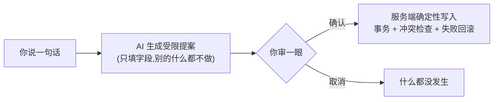

# 产品总览

[English](product-overview.md) | 简体中文

> 状态:Active(产品目标)
>
> 创建日期:2026-10-10
>
> 当前阶段:框架期,本文描述的是目标形态;工程现状见 [README.zh.md](README.zh.md)

## 产品定位

Toby 是单用户使用的自托管个人助手,定位像贴身书童:记日程、记笔记、管项目文件,替你把生活里的事记牢。

你在 Web 的单一对话框里用自然语言吩咐。系统听懂后**不直接动手**,而是生成一份受限提案:改哪张表、哪些字段、改成什么值。你核对后确认,服务端才写入;点取消,什么都没发生。

你是唯一用户,也是管理员。数据在自己机器上,默认只监听本机。

## 核心交互(写路径)

- 提案里看得见:目标、字段、修改前后的值。
- 确认的交互形态(显式点按钮还是继续对话即视为确认)随对话域设计定稿,框架期不预设。
- 与事务无关的闲聊,由只读的书童式回应接话;接不住就明说,不写入任何数据。

## 双端分工

两个 Web 应用,同一服务端:

| 端 | 入口 | 方向 |
| --- | --- | --- |
| PC | `/` | 承载复杂操作(如直接编辑、批量处理) |
| 移动 | `/m/` | 随时随地的便捷交互;复杂的事交给对话 |

复杂操作也必须走服务端写路径,不破"只有服务端能写"的边界。

## 功能范围(目标)

九个功能域,逐步落地,一域一 PR:

| 域 | 干什么 |
| --- | --- |
| `chat` 对话 | 单一持续对话页:意图路由分发各域,闲聊由只读回应接话 |
| `greeting` 问候 | 进入时的问候生成,AI 加兜底,不留存 |
| `schedule` 日程 | 记录项化日程:只读查询,增删改走提案 |
| `ledger` 记账 | 一句话记多笔,整批原子写入,月度汇总 |
| `notes` 手账 | 双轨 Markdown:按月流水 + 主题本,写入走提案 |
| `todo` 告示板 | 一次性待办:提案卡增删,PC 端可批量处理 |
| `memory` 记忆 | 长期偏好与约束的存取、检索,辅助提案质量 |
| `library` 书库 | 文件上传导入、书单与章节只读 |
| `proposals` 提案 | 提案生命周期的基础设施(生成 → 确认/取消 → 写入) |

本表只圈范围。各域的具体契约以落地时的 `docs/features/` 文档为准。

## 非目标

- AI 直接读文件、执行命令、连数据库或调用工具写入。
- 定时或后台静默自动执行提案。
- 客户端离线写入队列、自动重试确认。
- 多用户、权限体系、公网开放注册。
- 本地与服务器数据自动同步。
- 在客户端保存 AI 密钥、服务器凭据或本机文件路径。

## 成功标准

框架期(来自 PLAN.md):

- `pnpm run check` 四项全绿;`pnpm run dev` 起三端口;`pnpm run start` 单进程服务双端;Docker healthcheck 报 healthy。

产品期(每个域迁入后):

- 一个对话框完成所有写入;写前能完整审阅差异;取消永远零写入。
- 提交前重读目标字段,冲突拒绝写入并提示重新生成。
- 多字段写入失败时,事务回滚到修改前状态。
- 记忆不可用时,各域核心读写流程照常工作。

## 相关文档

- [README.zh.md](README.zh.md) —— 文档入口:工程现状、技术栈、端口
- [PLAN.md](../PLAN.md) —— 框架搭建计划
- [AGENTS.zh.md](../AGENTS.zh.md) —— 协作规则与铁律
