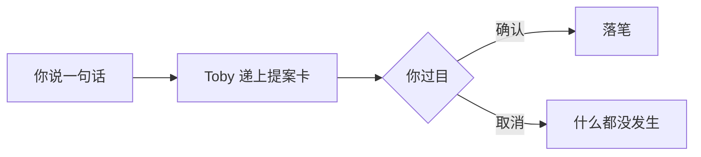

# 产品总览

[English](product-overview.md) | 简体中文

## 这是什么

Toby 是你的个人智能体：日程、待办、账目、笔记，说一句话它就递上提案——你确认，它才写入。

它装在你自己的电脑上，只有你一个人用。没有账号，没有云端，数据不出你的机器。

## 你怎么用它

打开网页，对着对话框说一句人话就行：

> "明天中午提醒我还款"
> "这周要把鞋子刷了"
> "今天打车花了 32，午饭 18"

Toby 听懂后不会直接动你的数据，而是递给你一张**提案卡**：要记什么、记到哪儿、什么值，写得清清楚楚。

不放心 AI 自作主张？这里它没有这个权限：它只能拟内容，笔永远在你手里。

## 在哪儿用

- **电脑**（`/`）：适合整理和批量处理
- **手机**（`/m/`）：随时随地，说一句就行

## 它能帮你记什么

- **日程**——每天要盯的事，问一句就知道今天有什么
- **待办**——一句话挂上告示板，办完划掉
- **记账**——一句话能记多笔，月底帮你算总账
- **手账**——你的原话原样记下，按月流水或主题本
- **书库**——导入文件，书单章节随时翻
- 还有**问候**和**记忆**：它记得你的偏好和习惯，越用越顺手

底座先搭好，这些能力一个一个上线。

## 它对你的承诺

- 数据只存在你自己的机器上
- AI 只能拟提案：不能自己写入、不能读你的文件、不能跑命令
- 写入前你看得见完整改动；点取消就是零写入
- 万一写入中途失败，整体退回，不会留半截

想看它内部怎么做到的，读[系统总览](system-overview.zh.md)；工程进度看 [README](../README.zh.md)。
