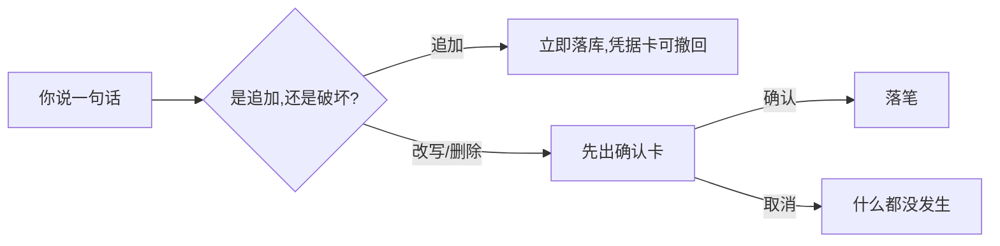

# 产品总览

[English](product-overview.md) | 简体中文

## 这是什么

Toby 是你的个人智能体：日程、待办、账目、笔记，说一句话——日常写入即刻落库、几分钟内可撤回；破坏性改动仍先等你确认。

它装在你自己的电脑上，只有你一个人用。没有账号，没有云端，数据不出你的机器。

## 你怎么用它

打开网页，对着对话框说一句人话就行：

> "明天中午提醒我还款"
> "这周要把鞋子刷了"
> "今天打车花了 32，午饭 18"

Toby 的每次写入都会递给你一张**写入卡**：要记什么、记到哪儿、什么值，写得清清楚楚。日常追加即刻落库——卡是凭据,带几分钟的撤回按钮;改写或删除你内容的操作则先出确认卡——破坏性改动绝不悄悄落地。

不放心 AI 自作主张？它唯一的权力是起草并经一个全程留痕的内核执行:内核之外它写不了任何东西,也读不了你的文件、跑不了命令——撤回也永远只由你亲手点。

## 在哪儿用

- **电脑**（`/`）：适合整理和批量处理
- **手机**（`/m/`）：随时随地，说一句就行

## 它能帮你记什么

- **日程**——每天要盯的事，问一句就知道今天有什么
- **待办**——一句话挂上告示板，办完划掉
- **记账**——一句话能记多笔，月底帮你算总账
- **手账**——你的原话原样记下，按月流水或主题本
- **书库**——导入文件，书单章节随时翻
- 还有**问候**和**记忆**：它记得你的偏好和习惯，越用越顺手

底座先搭好，这些能力一个一个上线。

## 它对你的承诺

- 数据只存在你自己的机器上
- AI 只经全程留痕的内核写入：内核之外不能写、不能读你的文件、不能跑命令
- 日常写入即刻落库、窗口内可撤回；破坏性改动先示确认——点取消就是零写入
- 万一写入中途失败，整体退回，不会留半截

想看它内部怎么做到的，读[系统总览](system-overview.zh.md)；工程进度看 [README](../README.zh.md)。
