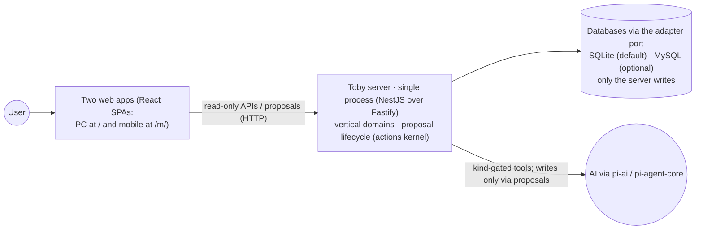
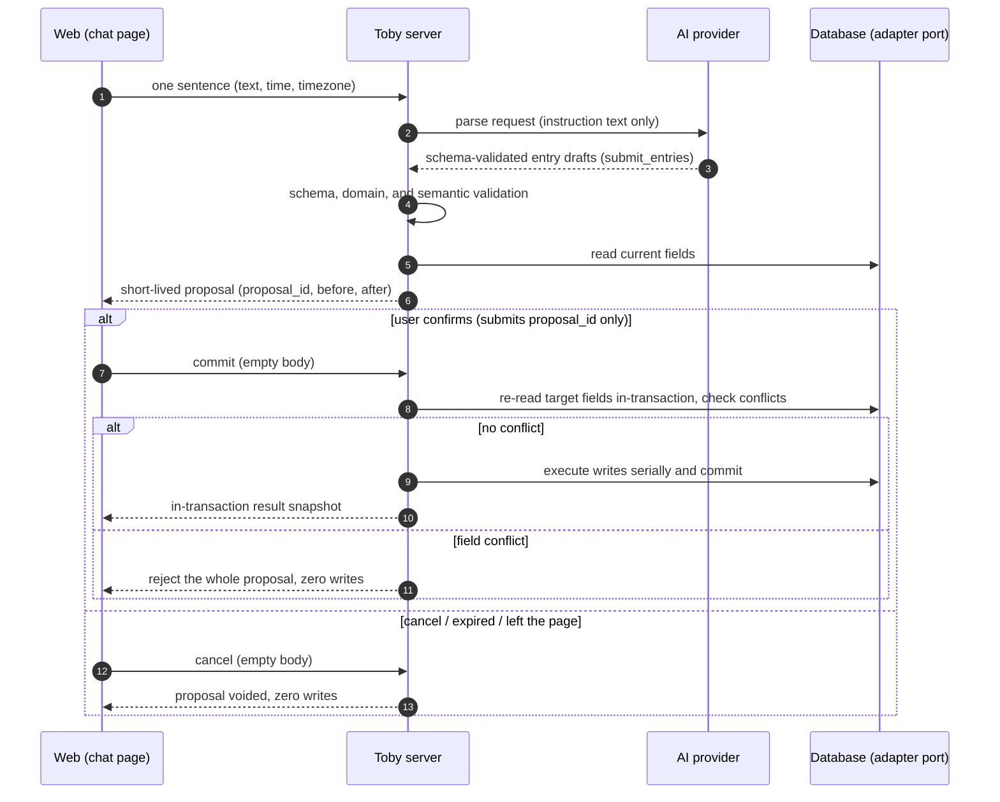
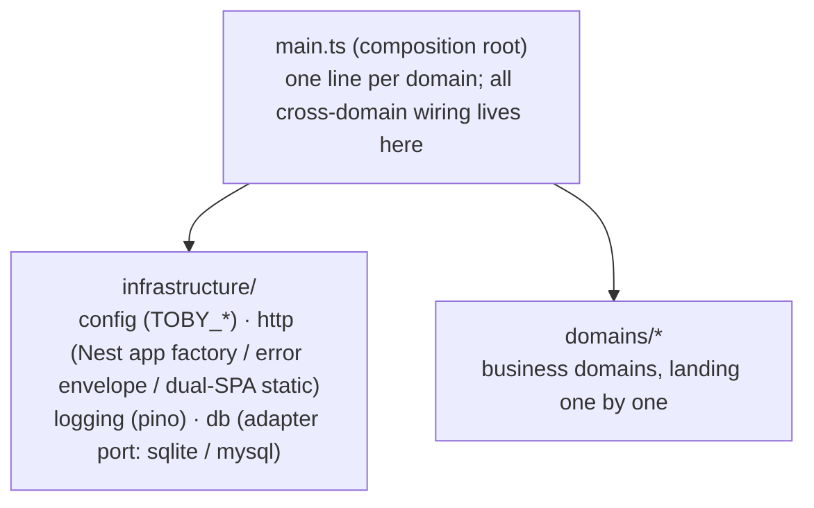

# System Architecture

English | [简体中文](system-overview.zh.md)

## Purpose

This document describes the repository's **module boundaries**, running processes, data flow, and dependency directions, at domain and process granularity.

Three documents, three layers: product scope is owned by the [Product Overview](product-overview.md); per-domain contracts and acceptance by the `docs/features/` docs; implementation details by code and tests.

## Stack

| Layer    | Choice                                                                                                                                                                               |
| -------- | ------------------------------------------------------------------------------------------------------------------------------------------------------------------------------------ |
| Runtime  | Node 22.23.2; server built with `nest build`, webs with Vite                                                                                                                         |
| Packages | pnpm 11.18.0 workspaces (`apps/*` + `packages/*`)                                                                                                                                    |
| Server   | NestJS 12 over Fastify 5 + own db adapter port — "port" as in ports-and-adapters, not a network port — (SQLite default, MySQL optional) + pino + typebox (AI: pi-ai + pi-agent-core) |
| Web      | React 19 + Vite 6 + Tailwind v4 + shadcn, two apps (PC `/`, mobile `/m/`)                                                                                                            |
| Tests    | vitest + happy-dom + @testing-library                                                                                                                                                |

## System context



- The web apps reach data only through server APIs; they never touch the file system.
- The server is the only daily read/write entry: queries go through read-only APIs; every create/update/delete must pass **proposal confirmation** — run by the shared **actions kernel** in `infrastructure/actions/` (one state machine: create / confirm / expire; ledger is live on it).
- AI tools carry a safety kind (read-only / write-intent) and run behind a policy gate; real effects still require proposal confirmation (docs/decisions/ai-pi-runtime.md).
- Root `scripts/` only orchestrates dev and multi-process startup; it never touches data.
- The remaining business domains (chat, greeting, schedule, notes, todo, memory, library) land one at a time; each establishes its contract doc in `docs/features/` on arrival. Proposal confirmation is already a shared kernel (see above), not a domain.

## Repository layout

```text
apps/
├─ server/        # @toby/server: NestJS single process — pages, APIs, proposals, safe writes
├─ web/           # @toby/web: PC app (entry /)
├─ web-mobile/    # @toby/web-mobile: mobile app (entry /m/)
packages/
├─ contract/      # @toby/contract: shared contract package for both apps (pure TS, zero JSX/CSS/DOM)
scripts/          # dev and multi-process orchestration (dev.js)
data/             # runtime data (domain databases and files), git-ignored, server-only writes
docs/             # product, architecture, ADRs, feature contracts, operations
test/             # root HTTP integration tests
```

- `apps/` holds independently runnable apps; the two web apps never import each other; cross-app sharing goes only through `@toby/contract` (pure logic).
- Dependency direction is always `apps → packages`: packages never import apps; web apps never import `@toby/server`.
- These boundaries are machine-enforced by ESLint `no-restricted-imports`; a violation fails the build.

## Runtime topology

### Development

`pnpm run dev` is orchestrated by `scripts/dev.js`: the server starts first; once ready it launches the two Vite dev servers. Vite exists only in dev — pages, hot reload, and the `/api` proxy; production has no Vite process. Dev ports (server 8629, webs 8630/8631) live in [docs/operations/local-dev.md](operations/local-dev.md); 8629 spells TOBY on a T9 keypad.

### Production or local preview

- `pnpm run start`: builds both web apps, then the server serves pages (`/` and `/m/`) and APIs from one process on `8629`.
- The server listens on loopback only by default; Docker binds `127.0.0.1:8629` only, with `./data` mounted as a volume.

## APIs and the proposal data flow (target shape)

One write, end to end (endpoint contracts are finalized in each domain's `features/` doc):



Two non-inferable details: the AI's draft passes shape, domain, and semantic validation before any proposal exists — `validation.ts` is the trust boundary; and client requests carry no state beyond the `proposal_id` (empty bodies on commit/cancel).

## Data boundaries

- `data/` is production data: nobody touches it by default; maintenance requires explicit user instruction, with SHA-256 compared before and after any move or restore.
- Daily reads go only through server APIs; daily writes only through proposal confirmation. Clients, AI, and scripts never connect to a database directly.
- Explicit `false` and numeric `0` are valid data, never treated as missing.
- The server edits field by field: `NULL` means missing, omitted on read; unrelated fields stay untouched.
- A multi-field commit is one database transaction; failure or interruption rolls back via the database. No user history, no undo.
- Each domain owns one database — a SQLite file `data/<domain>.db`, or a MySQL schema `toby_<domain>` when that dialect is on (see the [db adapter decision](decisions/db-adapter.md)); databases are never shared across domains.

## Security and dependency direction



Domain organization discipline:

- Every domain under `domains/` contains its own module (Nest module factory), controller, services, stores, and pure business files; **domains never import each other** — cross-domain wiring happens only in the composition root `apps/server/src/main.ts`.
- A domain's `types.ts` stays pure: no fastify, no infrastructure, no `node:` imports.
- `infrastructure/` never imports business domains; database opening is provided by `infrastructure/db` and consumed by domain stores.
- Adding a business domain means adding one row to ESLint's `DOMAIN_ALLOWED` table; the boundary rules generate themselves.

Security boundaries:

- HTTP write paths must go through proposal confirmation; any write endpoint bypassing it is a defect. Ledger is live on it; later domains reuse the same actions kernel (`infrastructure/actions/`).
- The AI gets no file paths, no data contents, and no shell; its tools are kind-gated, and write-intent tools only produce proposals (docs/decisions/ai-pi-runtime.md). Secrets live only in local environment config, never inside web bundles.
- Introducing new runtimes (Python etc.) requires an ADR first.
- These disciplines are machine-enforced by file-level ESLint rules (see `eslint.config.js`).

## Layout evolution rules

- Re-evaluate in-domain layering or splitting when a domain exceeds 15 files; split single files past 400 lines by concern.
- Configuration is resolved once at startup by `infrastructure/config`'s `resolveConfig({ env })` (`TOBY_*` environment variables); no global config at import time — the entry passes it explicitly, tests inject their own `env`.
- Web/packages `.ts` runs on Node 22 with no build step; the server is built with `nest build`. Style rules per package: see AGENTS.md (`erasableSyntaxOnly` still enforces web/packages).
- When adjusting layout, update this document and path references in affected docs in the same change; long-lived trade-offs get an ADR in `docs/decisions/`. The full maintenance rules live in the [living docs decision](decisions/living-docs.md).

## Glossary

Terms this repository uses with a specific meaning; one line each — the authoritative definition lives where the term is introduced.

| Term                           | Meaning                                                                                                                                           |
| ------------------------------ | ------------------------------------------------------------------------------------------------------------------------------------------------- |
| proposal / proposal card       | A short-lived, user-confirmable write suggestion; nothing is written until confirmed                                                              |
| actions kernel                 | The shared proposal-confirmation state machine in `infrastructure/actions/` (30 s tacit-approval window, TTL backstop, single-flight commit)      |
| safety kind                    | A tool's registered class: `read-only` (no state change) or `write-intent` (effect only via proposal); a `costly` kind is reserved for the future |
| gate (policy / shape / health) | Enforcement points: policy = tool kinds an agent may call; shape = TypeBox schema check; health = dev startup readiness                           |
| trust boundary                 | Deterministic server-side validation — the AI's output (and every other foreign input) is untrusted until it passes                               |
| adapter port                   | "Port" as in ports-and-adapters: the interface behind which SQLite / MySQL swap                                                                   |
| composition root               | `apps/server/src/main.ts` — the only place cross-domain wiring happens                                                                            |
| vertical domain slice          | One business = one directory owning its controller, service, store, and rules                                                                     |
| modular monolith               | Modules isolated in code, assembled and run by one process                                                                                        |
| single-flight                  | Concurrent confirms and the sweeper share one execution                                                                                           |
| error envelope                 | The unified `{ error: { code, message } }` response structure                                                                                     |
| sweeper                        | The periodic task that auto-writes due proposals and prunes expired ones                                                                          |
