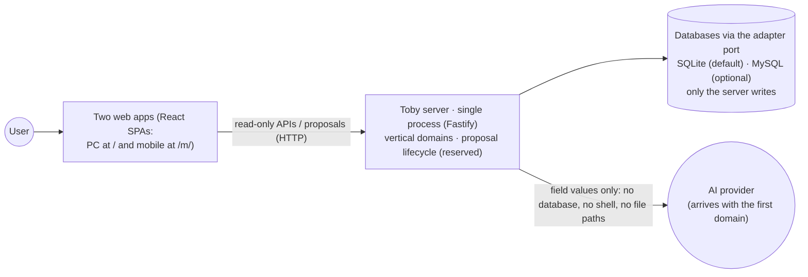
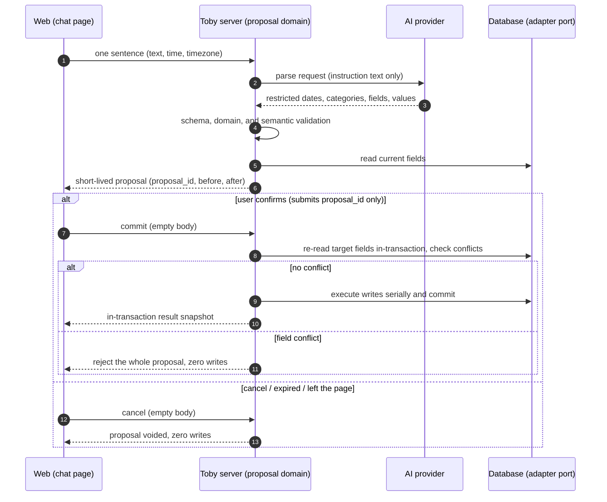
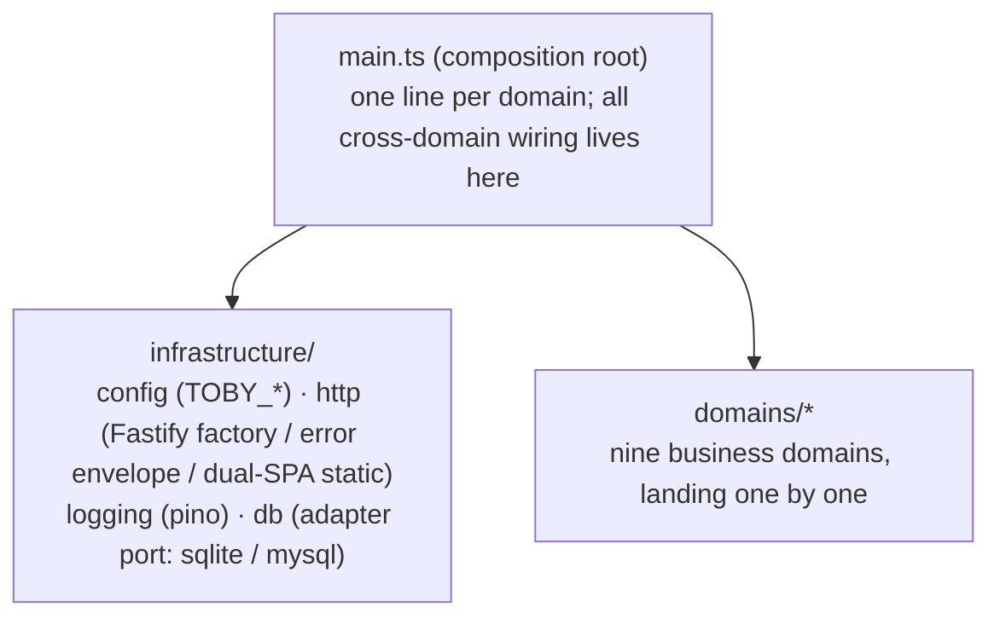

# System Architecture

English | [简体中文](system-overview.zh.md)

## Purpose

This document describes the repository's **module boundaries**, running processes, data flow, and dependency directions, at domain and process granularity.

Three documents, three layers: product scope is owned by the [Product Overview](product-overview.md); per-domain contracts and acceptance by the `docs/features/` docs; implementation details by code and tests.

## Stack

| Layer    | Choice                                                                        |
| -------- | ----------------------------------------------------------------------------- |
| Runtime  | Node 22.23.2, runs `.ts` directly, no build step                              |
| Packages | pnpm 11.18.0 workspaces (`apps/*` + `packages/*`)                             |
| Server   | Fastify 5 + own db adapter port (SQLite default, MySQL optional) + pino + zod |
| Web      | React 19 + Vite 6 + Tailwind v4 + shadcn, two apps (PC `/`, mobile `/m/`)     |
| Tests    | vitest + happy-dom + @testing-library                                         |

## System context



- The web apps reach data only through server APIs; they never touch the file system.
- The server is the only daily read/write entry: queries go through read-only APIs; every create/update/delete must pass **proposal confirmation** (the pipeline is an architectural reservation, landing with the first business domain).
- The AI receives field values only — no tools, no paths, no data contents.
- Root `scripts/` only orchestrates dev and multi-process startup; it never touches data.
- The nine business domains (chat, greeting, schedule, ledger, notes, todo, memory, library, proposals) land one at a time; each establishes its contract doc in `docs/features/` on arrival.

## Repository layout

```text
apps/
├─ server/        # @toby/server: Fastify single process — pages, APIs, proposals, safe writes
├─ web/           # @toby/web: PC app (entry /)
├─ web-mobile/    # @toby/web-mobile: mobile app (entry /m/)
packages/
├─ contract/      # @toby/contract: shared contract package for both apps (pure TS, zero JSX/CSS/DOM)
scripts/          # dev and multi-process orchestration (dev.js)
data/             # runtime data (domain databases and files), git-ignored, server-only writes
docs/             # product, architecture, ADRs, feature contracts, operations
test/             # root HTTP integration tests
```

- `apps/` holds independently runnable apps; the two web apps never import each other; cross-app sharing goes only through `@toby/contract` (pure logic).
- Dependency direction is always `apps → packages`: packages never import apps; web apps never import `@toby/server`.
- These boundaries are machine-enforced by ESLint `no-restricted-imports`; a violation fails the build.

## Runtime topology

### Development

`pnpm run dev` is orchestrated by `scripts/dev.js`: the server starts first; once ready it launches the two Vite dev servers. Vite exists only in dev — pages, hot reload, and the `/api` proxy; production has no Vite process.

| App        | Dev process | Address          | Role                                                        |
| ---------- | ----------- | ---------------- | ----------------------------------------------------------- |
| Web (PC)   | Vite        | `127.0.0.1:8630` | Pages and hot reload; proxies `/api` to the server          |
| Mobile web | Vite        | `127.0.0.1:8631` | Mobile pages and hot reload (entry `/m/`)                   |
| server     | itself      | `127.0.0.1:8629` | APIs and business domains (same port in dev and production) |

The ports form the 8629 block — 8629 spells TOBY on a T9 keypad.

### Production or local preview

- `pnpm run start`: builds both web apps, then the server serves pages (`/` and `/m/`) and APIs from one process on `8629`.
- The server listens on loopback only by default; Docker binds `127.0.0.1:8629` only, with `./data` mounted as a volume.

## APIs and the proposal data flow (target shape)

The full path of one write (endpoint contracts are finalized in each domain's `features/` doc):

1. The web chat page sends the user's sentence to the server.
2. The server routes by intent and dispatches to the matching domain's proposal pipeline.
3. The AI returns only restricted dates, categories, fields, and values; the server then applies schema, domain, and semantic validation.
4. The server reads current fields and produces a short-lived proposal carrying `proposal_id`, before and after values.
5. The client's only actions are confirm or cancel with that `proposal_id`; empty request bodies.
6. On commit the server re-reads target fields inside a database transaction, checks conflicts, executes serially, and commits — or rolls back entirely.



## Data boundaries

- `data/` is production data: nobody touches it by default; maintenance requires explicit user instruction, with SHA-256 compared before and after any move or restore.
- Daily reads go only through server APIs; daily writes only through proposal confirmation. Clients, AI, and scripts never connect to a database directly.
- Explicit `false` and numeric `0` are valid data, never treated as missing.
- The server edits field by field: `NULL` means missing, omitted on read; unrelated fields stay untouched.
- A multi-field commit is one database transaction; failure or interruption rolls back via the database. No user history, no undo.
- Each domain owns one database — a SQLite file `data/<domain>.db`, or a MySQL schema `toby_<domain>` when that dialect is on (see the [db adapter decision](decisions/db-adapter.md)); databases are never shared across domains.

## Security and dependency direction



Domain organization discipline:

- Every domain under `domains/` contains its own `module.ts` (self-assembly), `router.ts`, services, stores, and pure business files; **domains never import each other** — cross-domain wiring happens only in the composition root `apps/server/src/main.ts`.
- A domain's `types.ts` stays pure: no fastify, no infrastructure, no `node:` imports.
- `infrastructure/` never imports business domains; database opening is provided by `infrastructure/db` and consumed by domain stores.
- Adding a business domain means adding one row to ESLint's `DOMAIN_ALLOWED` table; the boundary rules generate themselves.

Security boundaries:

- HTTP write paths must go through the proposal pipeline; any write endpoint bypassing it is a defect. The framework phase has no write endpoints.
- The AI gets no file paths, no data contents, no shell, no write tools; secrets live only in local environment config, never inside web bundles.
- Introducing new runtimes (Python etc.) requires an ADR first.
- These disciplines are machine-enforced by file-level ESLint rules (see `eslint.config.js`).

## Layout evolution rules

- Re-evaluate in-domain layering or splitting when a domain exceeds 15 files; split single files past 400 lines by concern.
- Configuration is resolved once at startup by `infrastructure/config`'s `resolveConfig({ env })` (`TOBY_*` environment variables); no global config at import time — the entry passes it explicitly, tests inject their own `env`.
- `.ts` sources run directly on Node 22, no build step; no `enum` / `namespace` / constructor parameter properties; `import type` is enforced automatically by `erasableSyntaxOnly`.
- When adjusting layout, update this document and path references in affected docs in the same change.

## Architecture change rules

Before changing data sources, write boundaries, module responsibilities, inter-process communication, or exposure, update this document first; long-lived trade-offs get an ADR in `docs/decisions/`. Changes to user behavior, APIs, or data formats must also update the matching `features/` doc's contracts and acceptance criteria.
