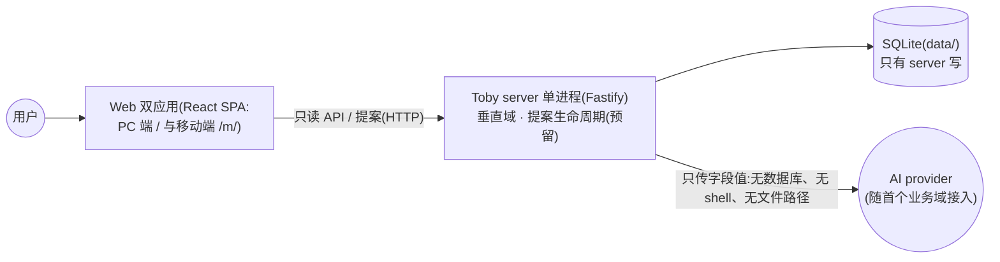
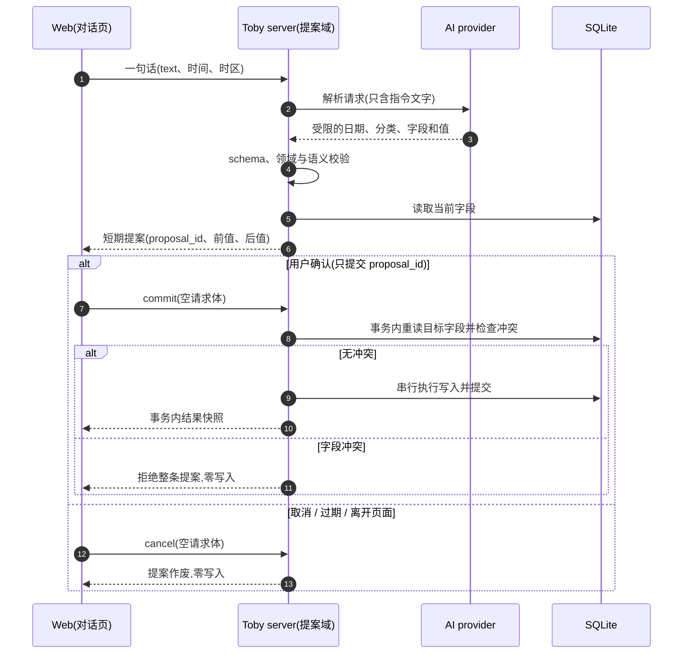
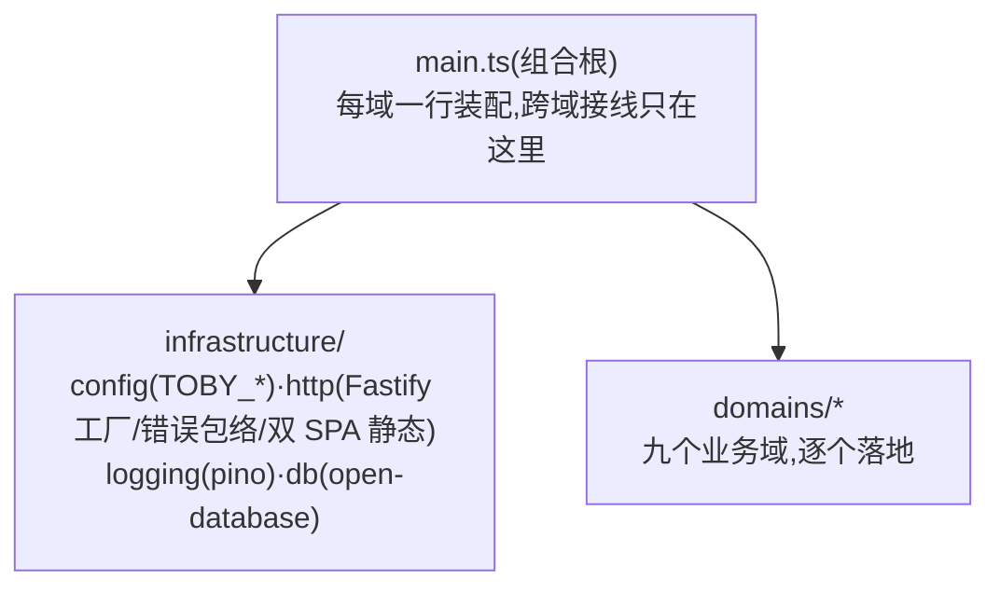

# 系统架构

[English](system-overview.md) | 简体中文

> 状态:Active(目标形态)
>
> 创建日期:2026-10-10
>
> 关联模块:全部
>
> 当前阶段:框架期,尚无代码。本文描述目标架构;实现细节以代码与测试为准。
>
> 更新纪律:只在产生 ADR 的时点更新本文(新域、重组、进程或依赖方向变化);没有 ADR 的变更不改本文。

## 目标

本文描述仓库采用的**模块边界**、运行进程、数据流和依赖方向,粒度为域级与进程级。

三份文档各管一层:产品范围以[产品总览](product-overview.zh.md)为准;功能契约与验收以 `docs/features/` 各域文档为准;实现细节以代码与测试为准。

## 系统上下文



- Web 只能通过 server API 访问数据,不能读取文件系统。
- server 是唯一日常读写入口:查询走只读 API;新增、修改和删除必须经**提案确认**(管线为架构预留,随首个业务域落地)。
- AI 只拿到字段值,没有工具、没有路径、没有数据内容。
- 根 `scripts/` 只做开发与多进程启动编排,不接触数据。
- 九个业务域(对话、问候、日程、记账、手账、告示板、记忆、书库、提案)逐个以独立 PR 落地;每个域落地时在 `docs/features/` 立契约文档。

## 仓库结构

```text
apps/
├─ server/        # @toby/server:Fastify 单进程——页面、API、提案与安全写入
├─ web/           # @toby/web:PC 端(入口 /)
├─ web-mobile/    # @toby/web-mobile:移动端(入口 /m/)
packages/
├─ contract/      # @toby/contract:双端共享契约包(纯 TS,零 JSX/CSS/DOM)
scripts/          # 开发与多进程启动编排(dev.js)
data/             # 运行数据(SQLite 与文件),Git 忽略,只有 server 写
docs/             # 产品、架构、ADR、功能契约与运维文档
test/             # 根 HTTP 集成测试
```

- `apps/` 存放可独立运行的应用;两个 Web 应用互不导入,跨端共享只经 `@toby/contract`(纯逻辑)。
- 依赖方向永远 `apps → packages`:packages 不导入 apps;Web 应用不导入 `@toby/server`。
- 以上边界由 ESLint `no-restricted-imports` 机器强制,违规即构建失败。

## 运行拓扑

### 开发模式

`pnpm run dev` 由 `scripts/dev.js` 编排:server 先起,就绪后拉起两个 Vite。Vite 只承载开发期页面、热更新与 `/api` 代理;生产形态没有 Vite 进程。

| 应用 | dev 进程 | 地址 | 职责 |
| --- | --- | --- | --- |
| Web(PC 端) | Vite | `127.0.0.1:8630` | 页面与热更新,`/api` 代理到 server |
| 移动端 Web | Vite | `127.0.0.1:8631` | 移动端页面与热更新(入口 `/m/`) |
| server | 自身 | `127.0.0.1:8629` | API 与业务域(开发与生产同端口) |

### 生产或本地预览

- `pnpm run start`:先构建两个 Web 应用,再由 server 单进程在 `8629` 同时提供页面(`/` 与 `/m/`)与 API。
- server 默认只监听回环地址;Docker 部署只绑 `127.0.0.1:8629`,数据经卷挂载 `./data`。

## API 与提案数据流(目标形态)

一次写入的完整路径(端点契约随各域 `features/` 文档定稿):

1. Web 对话页把用户一句话发给 server。
2. server 做意图路由,分发给对应域的提案管线。
3. AI 只返回受限的日期、分类、字段和值;server 再做 schema、领域和语义校验。
4. server 读取当前字段,生成带 `proposal_id`、前值和后值的短期提案。
5. 客户端仅凭 `proposal_id` 调用确认或取消,请求体为空。
6. 确认时 server 在 SQLite 事务中重读目标字段、检查冲突、串行执行并提交,或整体回滚。



## 数据边界

- `data/` 是生产数据:默认谁都不碰;维护任务需用户点名,挪动或恢复前后比对 SHA-256。
- 日常读取只经 server API;日常写入只经提案确认。客户端、AI 和脚本不能直连数据库。
- 显式 `false` 和数值 `0` 是有效数据,不能按缺失值处理。
- server 做字段级修改:SQLite `NULL` 表示缺失,读取时省略;无关字段保持不变。
- 多字段提交是一条 SQLite 事务;失败或中断由数据库回滚,不提供用户历史或撤销。
- 各域的数据库文件划分(`schedule.db` 等)随域 PR 落地时确定,互不混用。

## 安全与依赖方向



域组织纪律:

- `domains/` 下每个域自含 `module.ts`(域内自装配)、`router.ts`、service、store 与纯业务文件;**域与域互不导入**,跨域接线只发生在组合根 `apps/server/src/main.ts`。
- 域内 `types.ts` 保持纯净:不导入 fastify、infrastructure、`node:` 模块。
- `infrastructure/` 不导入业务域;开库能力由 `infrastructure/db` 提供,域内 store 消费。
- 新增业务域时,在 ESLint 的 `DOMAIN_ALLOWED` 表登记一行,边界规则自动生成。

安全边界:

- HTTP 写路径必须经提案管线;任何绕过提案的写端点都是缺陷。框架期没有任何写端点。
- AI 不获得文件路径、数据内容、shell 或写入工具;密钥只存在于本地环境配置,Web 包内不得包含密钥。
- 引入 Python 等新运行时需先立 ADR。
- 上述纪律由 ESLint 文件级规则机器强制(见 `eslint.config.js`)。

## 目录演进约定

- 单个域超过 15 个文件时,重新评估域内分层或拆子域;域内单文件超过 400 行时,按关注点拆分。
- 配置由 `infrastructure/config` 的 `resolveConfig({ env })` 启动时统一解析(`TOBY_*` 环境变量);不在导入时解析全局配置,入口显式传入,测试可注入独立 `env`。
- `.ts` 源码由 Node 22 直跑,无构建步骤;禁 `enum` / `namespace` / 构造器参数属性,`import type` 由 `erasableSyntaxOnly` 自动把关。
- 执行目录调整时,同步更新本文与受影响文档的路径引用。

## 架构变更规则

修改数据源、写入边界、模块职责、进程通信或暴露方式前,先更新本文;涉及长期取舍时新增 ADR 到 `docs/decisions/`。改变用户行为、API 或数据格式时,还必须更新对应 `features/` 文档的契约与验收标准。
