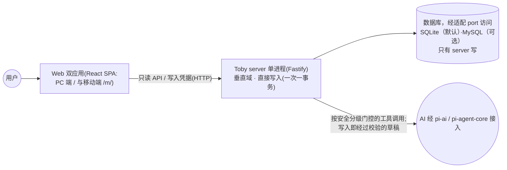
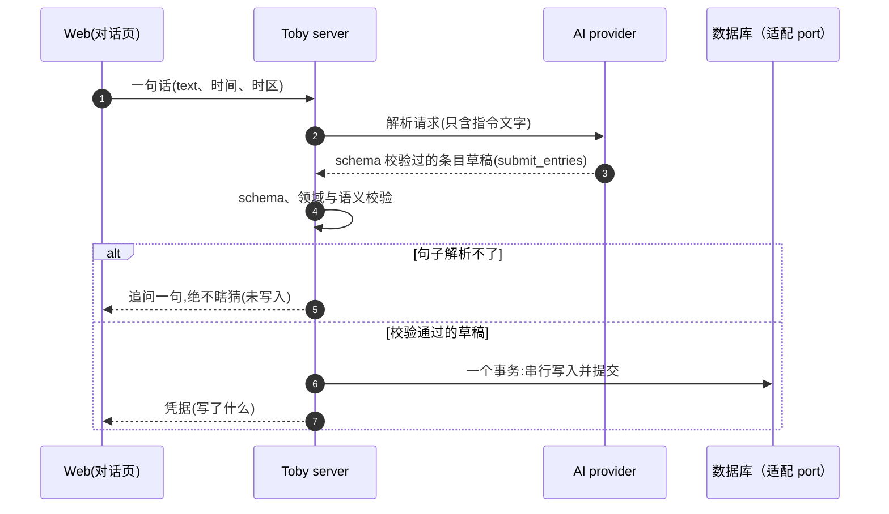
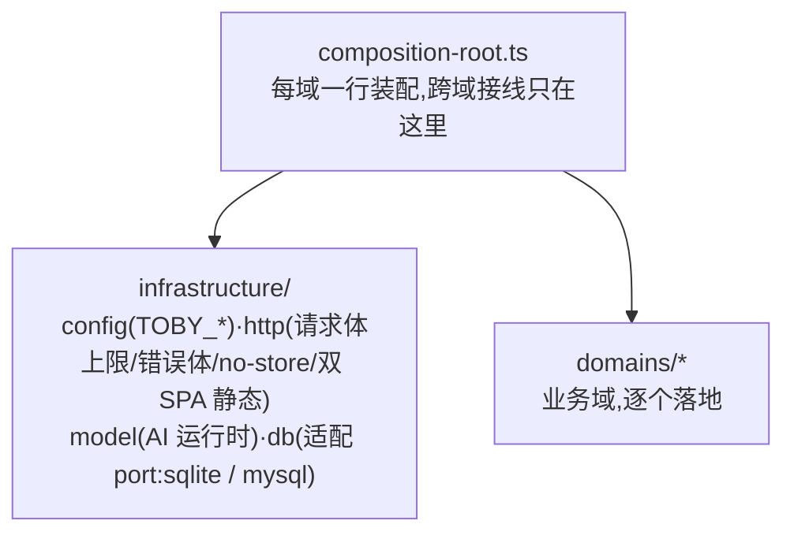

# 系统架构

[English](system-overview.md) | 简体中文

## 目标

本文描述仓库采用的**模块边界**、运行进程、数据流和依赖方向,粒度为域级与进程级。

三份文档各管一层:产品范围以[产品总览](product-overview.zh.md)为准;功能契约与验收以 `docs/features/` 各域文档为准;实现细节以代码与测试为准。

## 技术栈

| 层     | 选型                                                                                                                                         |
| ------ | -------------------------------------------------------------------------------------------------------------------------------------------- |
| 运行   | Node 22.23.2;服务端经 `tsc` 构建,前端经 Vite 构建                                                                                            |
| 包管理 | pnpm 11.18.0 workspaces(`apps/*` + `packages/*`)                                                                                             |
| 服务端 | Fastify 5 + 自建数据库适配 port —— 指 ports-and-adapters 架构概念,非网络端口 —— （默认 SQLite，可选 MySQL）+ zod（AI:pi-ai + pi-agent-core） |
| 前端   | React 19 + Vite 8 + Tailwind v4 + shadcn,双应用(PC `/`、移动端 `/m/`)                                                                        |
| 测试   | vitest + happy-dom + @testing-library                                                                                                        |

## 系统上下文



- Web 只能通过 server API 访问数据,不能读取文件系统。
- server 是唯一日常读写入口:查询走只读 API;新增、修改和删除一律是域仓库拥有的一次"先校验、后事务"的写入——没有提案、没有确认门;记账域已在使用。
- AI 工具携带安全分级(read-only / write-intent)并在策略门控下运行;write-intent 工具产生的效果是确定性校验加一次事务写入(docs/decisions/ai-pi-runtime.zh.md)。
- 根 `scripts/` 只做开发与多进程启动编排,不接触数据。
- 其余业务域(问候 greeting、日程 schedule、手账 notes、待办 todo、记忆 memory、书库 library)逐个独立落地;每个域落地时才在 `docs/features/` 立契约文档,不预写。写入规矩一句话共享,不是共享模块。

## 仓库结构

```text
apps/
├─ server/        # @toby/server:Fastify 单进程——页面、API、经校验的写入
├─ web/           # @toby/web:PC 端(入口 /)
├─ web-mobile/    # @toby/web-mobile:移动端(入口 /m/)
packages/
├─ contract/      # @toby/contract:双端共享契约包(纯 TS,零 JSX/CSS/DOM)
scripts/          # 开发与多进程启动编排(dev.js)
data/             # 运行数据（域数据库与文件），Git 忽略，只有 server 写
docs/             # 产品、架构、ADR、功能契约与运维文档
test/             # 根 HTTP 集成测试
```

- `apps/` 存放可独立运行的应用;两个 Web 应用互不导入,跨端共享只经 `@toby/contract`(纯逻辑)。
- 依赖方向永远 `apps → packages`:packages 不导入 apps;Web 应用不导入 `@toby/server`。
- 以上边界由 `test/boundaries.test.ts` 中的导入边界测试机器强制,违规即构建失败。

## 运行拓扑

### 开发模式

`pnpm run dev` 由 `scripts/dev.js` 编排:server 先起,就绪后拉起两个 Vite。Vite 只承载开发期页面、热更新与 `/api` 代理;生产形态没有 Vite 进程。开发端口(server 8629、前端 8630/8631)见 [docs/operations/local-dev.zh.md](operations/local-dev.zh.md);8629 在 T9 键盘上正好拼出 TOBY。

### 生产或本地预览

- `pnpm run start`:先构建两个 Web 应用,再由 server 单进程在 `8629` 同时提供页面(`/` 与 `/m/`)与 API。
- server 默认只监听回环地址;Docker 部署只绑 `127.0.0.1:8629`,数据经卷挂载 `./data`。

## API 与写入数据流(目标形态)

一次写入的完整路径(端点契约随各域 `features/` 文档定稿)。追加与破坏同一条直接写入路径:



两个无法靠推理得知的细节:AI 的草稿必须先过形状、领域与语义校验才会发生任何写入——`validation.ts` 是信任边界;写错了就再写一次或从备份恢复——产品内刻意没有 undo。

## 数据边界

- `data/` 是生产数据:默认谁都不碰;维护任务需用户点名,挪动或恢复前后比对 SHA-256。
- 日常读取只经 server API;日常写入每次都是一次经校验的仓库事务。客户端、AI 和脚本不能直连数据库。
- 显式 `false` 和数值 `0` 是有效数据,不能按缺失值处理。
- server 做字段级修改:`NULL` 表示缺失,读取时省略;无关字段保持不变。
- 多字段提交是一条数据库事务;失败或中断由数据库回滚。不提供用户历史,也不提供产品内 undo——刻意为之;恢复靠备份。
- 每个域拥有自己的数据库 —— SQLite 方言为文件 `data/<域>.db`,MySQL 方言为 schema `toby_<域>`(见[数据库适配器决策](decisions/db-adapter.zh.md));跨域永不共享数据库。

## 安全与依赖方向



域组织纪律:

- `domains/` 下每个域自含插件(自装配)、路由、service、store 与纯业务文件;**域与域互不导入**,跨域接线只发生在组合根 `apps/server/src/composition-root.ts`。
- 域内 `types.ts` 保持纯净:不导入 HTTP 适配器、infrastructure、`node:` 模块。
- `infrastructure/` 不导入业务域;开库能力由 `infrastructure/db` 提供,域内 store 消费。
- 新增业务域无需登记规则——`test/boundaries.test.ts` 的边界测试从文件系统自动发现各域。

安全边界:

- HTTP 写路径每次都是一次经校验的仓库事务;任何不是这样的写入——绕过、两段式、半截写入——都是缺陷。
- AI 不获得文件路径、数据内容与 shell;其工具经安全分级门控,write-intent(写意图)工具的效果是确定性校验加一次事务(docs/decisions/ai-pi-runtime.zh.md)。密钥只存在于本地环境配置,Web 包内不得包含密钥。
- 引入 Python 等新运行时需先立 ADR。
- 上述导入纪律由 `test/boundaries.test.ts` 机器强制。

## 目录演进约定

- 单个域超过 15 个文件时,重新评估域内分层或拆子域;域内单文件超过 400 行时,按关注点拆分。
- 配置由 `infrastructure/config` 的 `resolveConfig({ env })` 启动时统一解析(`TOBY_*` 环境变量);不在导入时解析全局配置,入口显式传入,测试可注入独立 `env`。
- 前端/packages 的 `.ts` 由 Node 22 直跑、无构建;服务端经纯 `tsc` 构建。各包风格规则见 AGENTS.md(`erasableSyntaxOnly` 对所有包生效,服务端也不例外)。
- 执行目录调整时,同步更新本文与受影响文档的路径引用;长期取舍新增 ADR 到 `docs/decisions/`。完整的维护规则见[文档维护决策](decisions/living-docs.zh.md)。

## 术语表

本仓库中带特定含义的术语,每词一行——权威定义见该术语首次出现处。

| 术语                               | 含义                                                                                                                    |
| ---------------------------------- | ----------------------------------------------------------------------------------------------------------------------- |
| 直接写入(direct write)             | 一切写入——追加或破坏——都是确定性校验加一次仓库事务;无提案、无确认门、无 undo                                            |
| 安全分级(safety kind)              | 工具注册时的类别:`read-only`(无状态改变)或 `write-intent`(真实效果:一次经校验的事务写入);`costly` 为将来预留            |
| 门控(policy / shape / health gate) | 三类强制点:policy = agent 可调用的工具分级;shape = Zod schema 校验;health = 开发期启动就绪检查                          |
| 信任边界(trust boundary)           | 服务端确定性校验——AI 输出(以及一切外来输入)通过校验之前都是非受信的                                                     |
| 适配 port(adapter port)            | ports-and-adapters 意义上的 port:SQLite / MySQL 在其后替换的接口                                                        |
| 组合根(composition root)           | `apps/server/src/composition-root.ts` —— 跨域接线唯一发生的地方                                                         |
| 垂直域切片(vertical domain slice)  | 一个业务 = 一个目录,自含路由、service、store 与规则                                                                     |
| 模块化单体(modular monolith)       | 模块在代码层隔离,由单进程装配运行                                                                                       |
| 错误体(error body)                 | 唯一错误形状:`{ statusCode, message, error }` 外加机器可读的 `errorCode`(净化后的 500 只保留 `statusCode` 与 `message`) |

中文域名对照:记账=ledger、对话=chat、问候=greeting、日程=schedule、手账=notes、待办=todo、记忆=memory、书库=library。
